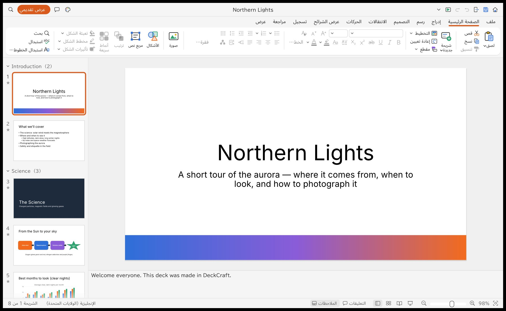
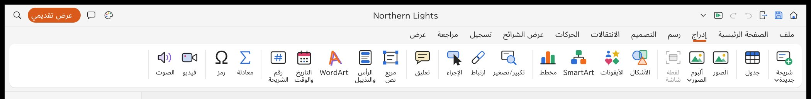

# DeckCraft بالعربية

تعريب واجهة **DeckCraft** (برنامج العروض التقديمية الشبيه ببرنامج PowerPoint) مع **شريط أدوات من اليمين إلى اليسار**،
لنسخة أندرويد التي يبنيها [artcraft-android](https://github.com/MostafaXS1/artcraft-android).





## المحتويات

| الملف | الوصف |
| --- | --- |
| `ar.tsv` | كتالوج الترجمة العربية: 1448 نصاً (القوائم، الشريط، مربعات الحوار، التلميحات، أسماء الحركات والانتقالات) |
| `deckcraft-arabic.patch` | التعديل على شيفرة DeckCraft (upstream `storytold/deckcraft` @ `fe510bd`) |
| `build-android-ar.sh` | يطبّق التعديل ويبني ملف APK عبر artcraft-android |

## ما يغيّره التعديل

- **لغة الواجهة:** تُختار العربية تلقائياً إذا كانت لغة الجهاز عربية، أو يدوياً من:
  ملف ← الحساب ← لغة الواجهة.
- **الترجمة:** لم يكن في DeckCraft نظام ترجمة، فأُضيف خطّاف واحد في محرك تخطيط النص (epaint)
  يترجم كل نص في الواجهة لحظة رسمه، فيُقاس ويُرسم بالعربية معاً. النصوص التي يكتبها المستخدم
  (الشرائح، الملاحظات، التعليقات) لا تُترجم أبداً. والنصوص المركّبة مثل «الشريحة 1 من 8» تُطابق
  قوالب في الكتالوج.
- **الشريط من اليمين إلى اليسار:** علامات التبويب تبدأ من اليمين («ملف» أولاً)، والمجموعات تتوالى
  من اليمين، والأزرار الصغيرة أيقونتها على اليمين ونصها على اليسار، وأسهم القوائم المنسدلة
  على اليسار. شريط العنوان معكوس أيضاً: شريط الوصول السريع يميناً و«عرض تقديمي» والبحث يساراً.

## البناء لأندرويد

```sh
git clone https://github.com/MostafaXS1/artcraft-android
bash deckcraft-arabic/build-android-ar.sh ./artcraft-android
# الناتج: artcraft-android/output/deckcraft-<version>.apk
```

## قيود معروفة

- محتوى صفحات «ملف» ومربعات الحوار مترجَم، لكن ترتيب عناصرها ما زال من اليسار إلى اليمين.
- القوائم المنبثقة نصها عربي لكنه محاذى لليسار.
- النص الطويل الذي يلتف على عدة أسطر تُقرأ أسطره من الأسفل للأعلى.
