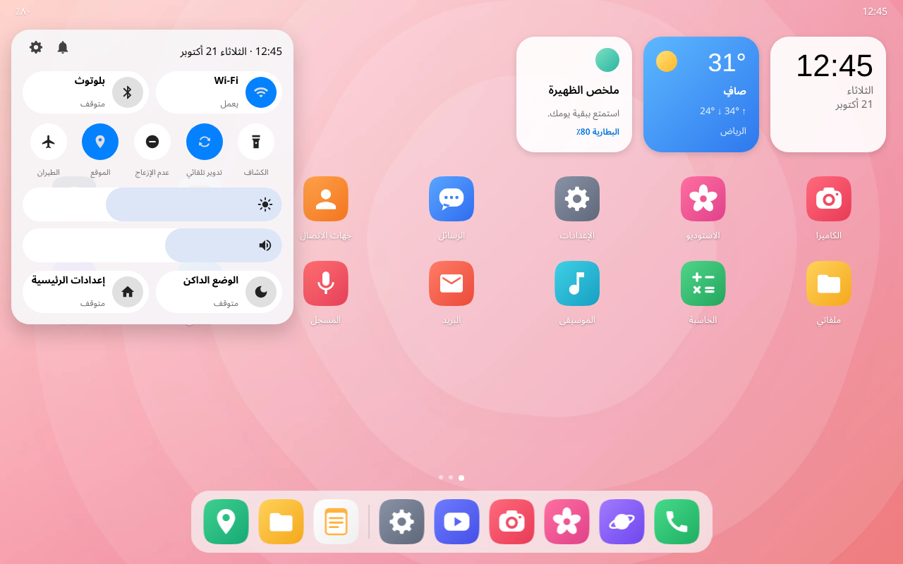

# هلا — واجهة رئيسية لجهاز Honor MagicPad 4

**هلا (Hala Home)** تطبيق واجهة رئيسية (Launcher) مستقل لأجهزة أندرويد اللوحية، صُمم بروح
**إرشادات One UI المنشورة** من سامسونج: الزوايا الدائرية الواسعة («كتل التركيز»)، والأزرق
الأساسي `#0381FE`، والهوامش ٢٤ وحدة، وترتيب الخطوط من ٤٠ إلى ١٣. الكود كله أصلي، ولا يحتوي على
أي أيقونات أو صور أو خطوط أو شيفرة من سامسونج.



*(صورة معاينة مرسومة من ملفات التصميم نفسها، وليست لقطة من الجهاز.)*

## ما الذي فيه

- **أيقونات بنمط One UI** للتطبيقات المدمجة في الجهاز: الكاميرا، الاستوديو، الإعدادات، الهاتف،
  الرسائل، جهات الاتصال، الساعة، التقويم (يعرض تاريخ اليوم)، الحاسبة، ملفاتي، البريد، المتصفح،
  الموسيقى، الملاحظات، المسجل، الطقس، السمات، الصحة، العناية بالجهاز، الفيديو، الخرائط، التنزيلات.
  رسمتها من الصفر (`design/icons.py`)، وتطبيقات Google والتطبيقات التي تثبّتها أنت تبقى بأيقوناتها.
- **أدوات (Widgets)** أعلى الشاشة: ساعة، وطقس موقعك (من خدمة Open-Meteo المجانية بعد إذن الموقع
  التقريبي)، وملخص اليوم مع نسبة البطارية.
- **اللوحة السريعة**: اسحب لأسفل على النصف الأيمن (الأيسر بالعربية) لتظهر لوحة زجاجية فيها Wi-Fi
  وبلوتوث، والكشاف، والتدوير التلقائي، وعدم الإزعاج، والموقع، ووضع الطيران، وشريطا السطوع والصوت،
  والوضع الداكن. اسحب على النصف الآخر للإشعارات.
- **خلفيات هلا**: أربع خلفيات أصلية (خوخي، سماوي، نعناعي، ليلي) تُعيَّن بضغطة من الإعدادات.
- **الشاشة الرئيسية**: صفحات أيقونات بشبكة قابلة للتعديل ونقاط الصفحات (والساعة الكبيرة إن أطفأت الأدوات).
- **شريط التطبيقات السفلي (Dock)**: شريط زجاجي دائري للتطبيقات المثبتة (حتى ١٠)، وبعده
  آخر ٣ تطبيقات استُخدمت كما في أجهزة سامسونج اللوحية (بعد منح إذن «الوصول إلى الاستخدام»).
- **درج التطبيقات**: اسحب لأعلى من أي مكان؛ بحث يفهم العربية (يوحّد الهمزات والتاء المربوطة
  والياء) ويفتح أول نتيجة عند الضغط على «انتقال»، واسحب لأسفل لإغلاقه.
- **ضغطة مطولة على أيقونة**: قائمة (إزالة، معلومات التطبيق، إلغاء التثبيت، إضافة للرئيسية أو
  للشريط)، ومع تحريك الإصبع تُسحب الأيقونة لنقلها بين الصفحات أو إلى الشريط. اسحبها إلى
  طرف الشاشة لتنتقل للصفحة التالية.
- **ضغطة مطولة على مكان فارغ**: الإعدادات — الأعمدة والصفوف (لكل اتجاه)، حجم الأيقونات،
  إظهار الأسماء، المظهر فاتح/داكن/حسب النظام، التطبيقات الأخيرة، الخلفية، واختيار الواجهة
  الافتراضية.
- أيقونات بشكل **السكويركل** (المربع الدائري) لكل التطبيقات، ودعم الملف الشخصي للعمل.
- **العربية من اليمين لليسار** بالكامل: الصفحة الأولى على اليمين، والأعمدة معكوسة.

## التثبيت

1. انسخ `HalaHome-2.0.apk` إلى الجهاز وثبّته (اسمح بالتثبيت من هذا المصدر إن طُلب).
2. اضغط زر الرئيسية واختر **هلا** ثم «دائمًا»، أو من:
   الإعدادات › التطبيقات › التطبيقات الافتراضية › تطبيق الشاشة الرئيسية.
3. (اختياري) للتطبيقات الأخيرة في الشريط: الإعدادات داخل هلا › «التطبيقات الأخيرة»
   ثم فعّل إذن «الوصول إلى الاستخدام» لهلا.

## ما لا يستطيعه أي Launcher

تطبيق الواجهة الرئيسية يرسم الشاشة الرئيسية فقط. شكل تطبيق الإعدادات نفسه، وتطبيق الكاميرا من
الداخل، ولوحة الإشعارات الحقيقية، وشريط المهام فوق التطبيقات، وتقسيم الشاشة: هذه كلها جزء من نظام
MagicOS، ولا يغيّرها إلا تعديل النظام نفسه (روت أو نظام معدَّل)، ولا يفتحها «وضع المطور». لذلك
بعض أزرار اللوحة السريعة (Wi-Fi، بلوتوث، الموقع، الطيران) تفتح عنصر التحكم الخاص بالنظام، لأن
أندرويد لا يسمح لتطبيق عادي بتشغيلها مباشرة.

## الأذونات

- **الموقع التقريبي والإنترنت**: لبطاقة الطقس فقط؛ تُرسَل الإحداثيات التقريبية إلى Open-Meteo.
- **تعديل إعدادات النظام**: للسطوع والتدوير التلقائي من اللوحة السريعة (يطلبه هلا عند أول استخدام).
- **الوصول إلى «عدم الإزعاج»**: لزر عدم الإزعاج.
- **الوصول إلى الاستخدام**: للتطبيقات الأخيرة في الشريط السفلي.

## الرجوع إلى واجهة أونر الأصلية

لا يغيّر هلا شيئًا في النظام. للرجوع في أي وقت:
- من إعدادات هلا › «اختيار تطبيق الشاشة الرئيسية الافتراضي» واختر واجهة أونر (Honor Home)، أو
- من إعدادات الجهاز › التطبيقات › التطبيقات الافتراضية › تطبيق الشاشة الرئيسية، أو
- ألغِ تثبيت هلا فقط، فيعود الجهاز لواجهته تلقائيًا.

## التصميم

- `design/icons.py`: يرسم الأيقونات والرموز ويكتبها SVG للمعاينة وVectorDrawable للتطبيق
  (بعض الرموز من Material Icons برخصة Apache 2.0).
- `design/wallpapers.py`: الخلفيات، و`design/render.sh` يحوّلها إلى WebP.
- `design/mock.html`: صفحة المعاينة أعلاه.

## البناء من المصدر

يحتاج أدوات Android SDK السطرية فقط (بدون Gradle): `aapt2` و`javac` و`d8` (أو `dx`)
و`zipalign` و`apksigner`، ومنصة API 35:

```sh
ANDROID_HOME=/path/to/sdk bash build.sh
```

يُوقَّع بمفتاح تطوير محفوظ في المستودع (`hala-dev.keystore`، كلمة السر `hala-dev`) حتى تُحدِّث كل
نسخة جديدة النسخة السابقة دون حذفها. هذا المفتاح عام؛ للنشر على متجر استخدم مفتاحك الخاص.

## ملاحظات

- لم يُجرَّب على جهاز حقيقي بعد؛ إن واجهت مشكلة صف ما حدث وسأصلحه.
- واجهة MagicOS الأصلية لا تُحذف ولا تُعدَّل؛ هلا تطبيق عادي يمكن إزالته.
- «One UI» علامة تجارية لسامسونج؛ هذا المشروع غير تابع لها، ويتبع إرشاداتها المنشورة للمطورين فقط.
