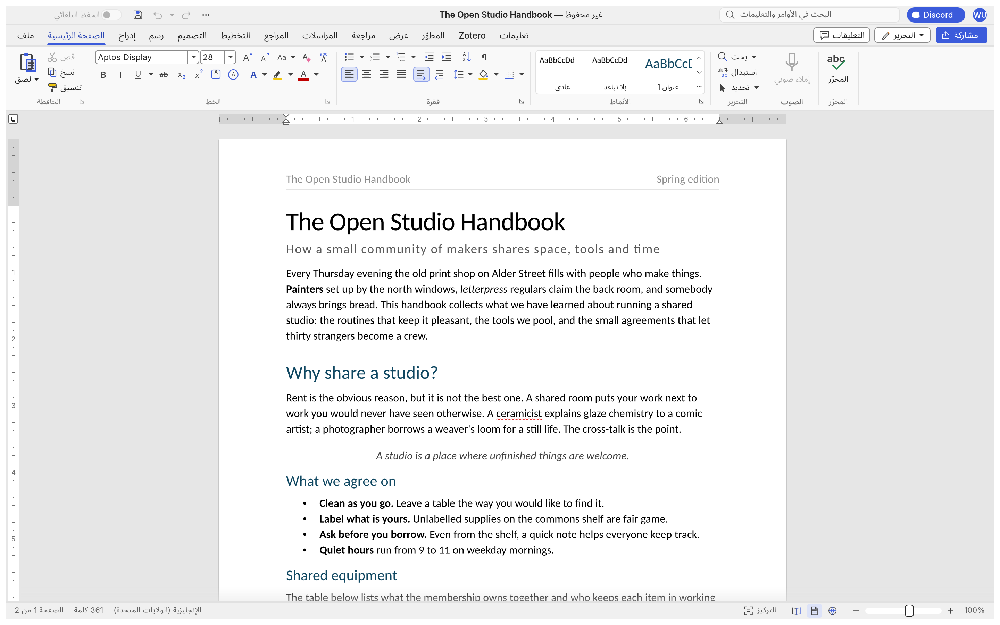

# WordCraft بالعربية

تعريب كامل لواجهة **WordCraft** (معالج النصوص الشبيه ببرنامج Word) الذي يبنيه
[artcraft-android](https://github.com/MostafaXS1/artcraft-android) لأندرويد.



## المحتويات

| الملف | الوصف |
| --- | --- |
| `ar.tsv` | كتالوج الترجمة العربية: 2674 نصاً (كل نصوص الواجهة) |
| `wordcraft-arabic.patch` | التعديل على شيفرة WordCraft (upstream `storytold/wordcraft` @ `e6c5a70`) |
| `build-android-ar.sh` | يطبّق التعديل ويبني ملف APK عبر artcraft-android |

## ما يغيّره التعديل

- يضيف العربية (`ar`) إلى لغات الواجهة. تُختار تلقائياً عندما تكون لغة الجهاز عربية،
  أو يدوياً من: ملف › الخيارات › لغة الواجهة.
- **الاتجاه من اليمين لليسار:** مكتبة egui ترسم الأحرف العربية متصلة لكنها ترتّب الكلمات
  من اليسار لليمين. لذلك يُعاد ترتيب كل نص عربي لترتيب العرض عند تحميل الكتالوج
  (خوارزمية Unicode Bidi)، مع الحفاظ على `{المتغيرات}` والأرقام والكلمات اللاتينية
  وعكس الأقواس.
- **الخط:** يستخدم خط Noto Sans Arabic من `craft-fonts` لواجهة البرنامج، وإن لم يتوفر
  يستعير خطاً عربياً مثبتاً في النظام. وعلى أندرويد أُضيف المجلد `/system/fonts`
  إلى مجلدات البحث عن الخطوط.
- اختبارات جديدة: التغطية الكاملة للنصوص، والترتيب من اليمين لليسار، وتغطية الخط.

## البناء لأندرويد

```sh
git clone https://github.com/MostafaXS1/artcraft-android
bash build-android-ar.sh ./artcraft-android
# الناتج: artcraft-android/output/wordcraft-<version>.apk
```

يتطلب ما يتطلبه artcraft-android نفسه: Android SDK وNDK و`rustup target add aarch64-linux-android`.

## قيود معروفة

- النص الطويل الذي يلتف على عدة أسطر داخل مربع حوار تُقرأ أسطره من الأسفل للأعلى
  (الكلمات داخل كل سطر صحيحة). معظم نصوص الواجهة قصيرة فلا يظهر ذلك فيها.
- تخطيط الواجهة نفسه (الشريط والقوائم) يبقى من اليسار لليمين؛ النصوص فقط معرّبة.
- ما تكتبه في حقول الإدخال (مثل البحث) يُعرض كما ترسمه egui. أما المستند نفسه فيدعم
  العربية بالكامل.
